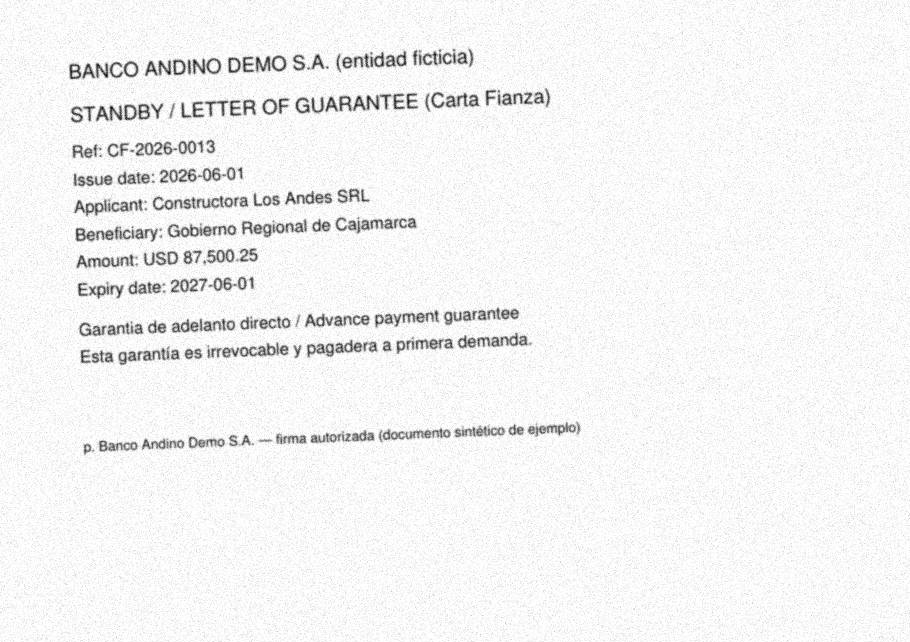
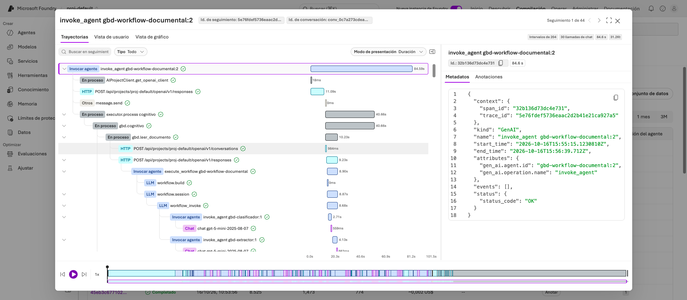

# Gestión Bancaria Documental

Agente de tipo **workflow** que concilia cartas fianza contra el Registro de Garantías de Tesorería. Se inspira en el caso público de automatizar «Billetes Retenidos» en un banco: procesar Excel y PDF, ejecutar ETL, consolidar en una base y conciliar con reglas de negocio, mientras el analista se concentra en revisar excepciones.

Todo el caso es **sintético**: entidad ficticia («Banco Andino Demo»), documentos generados y ninguna credencial en el repo.


El diagrama editable está en [`docs/arquitectura.drawio`](docs/arquitectura.drawio).

## Qué hace

1. **Ingesta** una bandeja de PDF y el Excel de Tesorería (idempotente por `sha256`) y **lee cada PDF por capas** para recuperar el máximo texto: nativo por bloques (PyMuPDF), OCR (Tesseract) y visión del modelo ([detalle](#lectura-de-pdf-recuperación-por-capas)).
2. **Clasifica y extrae** con un *workflow de Microsoft Foundry*: carta fianza, oficio de liberación u otro. Si es carta fianza, devuelve sus campos en JSON estricto, aunque el PDF venga en español, en inglés o con formatos distintos.
3. **Verifica el anclaje**: número, monto y fecha extraídos deben aparecer en el texto leído. Si no, relee con visión; si sigue sin anclar, el documento pasa a revisión humana (`LECTURA_DUDOSA`) en vez de entrar como dato falso.
3. **Carga** documentos y cartas en Postgres, con el método de lectura y la confianza de cada uno.
4. **Concilia** con reglas puras y auditables: monto, moneda, vencimiento, beneficiario, duplicadas, vencidas, por vencer, no registradas y registros sin carta.
5. **Explica las excepciones**: recupera las políticas internas con búsqueda vectorial (pgvector) y un agente de Foundry propone la acción, citando solo las políticas recuperadas.
6. **Deja la decisión al analista** (`gbd revisar`): aprobar, rechazar o escalar. El agente propone y nunca resuelve solo.
7. **Consulta de agencias** por una API de solo lectura (rol `gbd_lector`), sin acceso al texto de los documentos.

## Por qué un workflow y no un agente autónomo

El proceso tiene pasos conocidos, orden fijo y reglas de negocio que deben ser auditables. La conciliación es **código determinista** (`src/gbd/dataplane/reglas.py`). El modelo solo interviene donde hace falta lenguaje: leer documentos y redactar la explicación. Un agente autónomo con herramientas añadiría variabilidad donde el banco necesita trazabilidad.

| Nodo | Dónde corre | Tipo |
|---|---|---|
| Ingestar, Cargar, Conciliar, Resumen | Contenedor Docker | determinista |
| Clasificar → Extraer | **Foundry** (workflow `gbd-workflow-documental`) | cognitivo |
| Explicar excepción | **Foundry** (agente `gbd-analista-excepciones`) | cognitivo + RAG |
| Decidir la excepción | Analista | humano (HITL) |

## Lo que se ve en Microsoft Foundry

Los agentes y el workflow se publican con el SDK y quedan en **Build → Agents** y **Build → Agents → Flujos de trabajo**, con visualizador, YAML, versiones y seguimientos (trazas) de cada corrida.

| Agentes `gbd-*` | Workflow en el visualizador |
|---|---|
|  |  |

> **Aviso importante.** Microsoft anunció que **retirará los workflows de Foundry el 1 de diciembre de 2026** y recomienda Microsoft Agent Framework. Por eso este proyecto separa los dos niveles: la orquestación local ya usa Agent Framework (`src/gbd/workflow/graph.py`), y el workflow declarativo de Foundry (`agents/workflow-documental.yaml`) es un YAML portable. Después de esa fecha, la ruta de migración es desplegar la orquestación como *hosted agent* con esta misma imagen. Con ese cambio la base debe ser alcanzable desde la nube, por ejemplo Azure Database for PostgreSQL con pgvector.

## Lectura de PDF: recuperación por capas

Un PDF puede traer texto, ser un escaneo o mezclar ambos (texto con un sello incrustado). `src/gbd/dataplane/extraccion.py` decide por página y deja registrado qué hizo:

| Capa | Cuándo entra | Qué hace |
|---|---|---|
| **1. Nativo** (PyMuPDF) | Siempre que haya capa de texto | Bloques en orden de lectura (y, x). Gratis y exacto. |
| **2. OCR** (Tesseract `spa+eng`) | Página sin texto útil, o imagen > 40 % del área | Corrige giro (OSD) e inclinación, prueba 4 preprocesados y se queda con el que lee **más palabras fiables**. |
| **2b. OCR por región** | Texto nativo + imágenes incrustadas (sellos, firmas) | Lee solo esas imágenes y suma las líneas que el texto nativo no tenía. |
| **3. Visión** (gpt-5-mini en Foundry) | Resolución efectiva < 150 dpi, OCR < 70 %, o dato sin anclar | Transcribe la imagen. Es el respaldo, no el camino principal. |
| **Anclaje** | Después de extraer | Comprueba sin modelo que número, monto y fecha existan en el texto (acepta `1,234.50`, `1.234,50`, `31/12/2026`, «31 de diciembre de 2026»). |

Dos lecciones medidas con las muestras, que motivaron el diseño:

- **La confianza media del OCR engaña.** En el escaneo degradado, la variante con 94 % de confianza leyó 1 de 7 datos clave; las de 91–93 % leyeron 4. Por eso se elige por **palabras fiables leídas**, no por confianza media.
- **Un OCR puede equivocarse con seguridad.** Leyó «SAL» en vez de «SRL» con 92 % de confianza: ninguna regla basada en confianza lo detecta. Lo que sí es medible es la **resolución de la imagen** (110 dpi en el escaneo degradado frente a 200 en el limpio), y bajo 150 dpi se usa visión.



## Árbol del proyecto

```
.
├── agents/                  # Definiciones declarativas de Foundry (prompt agents + workflow CSDL)
├── src/gbd/
│   ├── workflow/graph.py    # Orquestación (Microsoft Agent Framework): 6 executors
│   ├── agents/deploy.py     # Publica agentes y workflow en Foundry (versiones inmutables)
│   ├── dataplane/           # extraccion.py (PyMuPDF · OCR · visión), anclaje.py, reglas.py (puras), etl.py
│   ├── telemetry.py         # Spans OpenTelemetry → Application Insights (GBD_OTEL=1)
│   ├── rag/politicas.py     # Indexado y recuperación con pgvector
│   ├── api/app.py           # Canal de consulta (solo lectura)
│   ├── foundry.py           # Cliente Foundry (Entra ID; sin API keys)
│   └── cli.py               # `gbd migrate | indexar-politicas | deploy-agentes | run | revisar | api`
├── dataplane/
│   ├── sql/                 # Esquema idempotente (schema doc, HNSW, rol gbd_lector)
│   ├── policies.md          # Políticas internas (corpus del RAG)
│   ├── generar_muestras.py  # PDFs/Excel sintéticos con anomalías plantadas + verdad esperada
│   └── samples/             # Bandeja de ejemplo y esperado.json
├── evals/run_eval.py        # Evaluación contra la verdad plantada
├── tests/                   # Unitarios + integración con pgvector
├── docker/                  # Dockerfile (usuario no root, sin secretos) y compose
├── .github/workflows/       # ci · docker (GHCR) · deploy-agents (OIDC, manual)
├── docs/                    # Arquitectura (.drawio + imágenes)
└── Makefile
```

## Cómo correrlo

Requisitos: Docker, Python 3.12+ y una suscripción con un proyecto de Microsoft Foundry que tenga un deployment de chat (`gpt-5-mini`) y otro de embeddings (`text-embedding-3-small`). Debes haber iniciado sesión con `az login` en un tenant que tenga acceso al proyecto.

```bash
cp .env.example .env            # completa POSTGRES_PASSWORD y FOUNDRY_PROJECT_ENDPOINT
make install && make up         # Postgres + pgvector en Docker
make migrate policies           # esquema + embeddings de las políticas
make deploy-agents              # publica agentes y workflow en tu proyecto Foundry
make run                        # ejecuta el workflow sobre la bandeja de ejemplo
make eval                       # compara contra la verdad plantada
.venv/bin/gbd revisar           # cola del analista
```

Dentro del contenedor, con la misma imagen que publica CI:

```bash
make docker-build
make docker-run                 # genera tokens efímeros en out/ (ignorado) y corre el workflow
```

## Resultados de la prueba end to end

Corrida sobre 16 PDF y 1 Excel con 15 garantías (5 conciliadas, 1 alerta, 9 excepciones). Entre los PDF hay 11 con capa de texto, 1 escaneo limpio, 1 escaneo degradado (110 dpi, inclinado, con ruido), 1 con sello incrustado, una factura y un oficio fuera de alcance. Se ejecutó desde cero, con Postgres recién creado, en el host y **dentro del contenedor**:

```
clasificación : 16/16
extracción    : 78/78 campos
   · nativo             60/60 campos  (lectura: nativo)
   · escaneo_limpio      6/6 campos   (lectura: ocr 96 %)
   · escaneo_degradado   6/6 campos   (lectura: visión · 110 dpi)
   · mixto_sello         6/6 campos   (lectura: nativo+ocr)
conciliación  : 15/15 garantías con los códigos exactos
política citada: 9/9 excepciones
```

Para saber **cuánto aporta cada capa**, la primera corrida con solo OCR (sin la regla de resolución) dio 77/78: el OCR leyó «SAL» por «SRL» con 92 % de confianza, y la visión lo corrigió. Los campos críticos para conciliar (número, monto, moneda, fecha) salieron bien también con solo OCR.

### La traza

Con `GBD_OTEL=1`, cada corrida imprime su `operation_id` y deja un solo árbol en Foundry (**Agents → workflow → Seguimientos**): los nodos locales (`gbd.cognitivo`, `gbd.leer_documento`) quedan anidados con la ejecución del workflow y las llamadas al modelo.



Una corrida completa de 16 documentos tomó ~40 s y ~0,03 US$ estimados por Foundry (precio de lista del modelo; no incluye cómputo local).

Idempotencia comprobada: una segunda corrida sobre la misma bandeja reporta 0 documentos nuevos y no reabre excepciones que ya están en la cola.

**Límites que conviene conocer**

- Los PDF son sintéticos y generados por mí: validan el diseño, no el rendimiento sobre documentos reales de un banco. No hay manuscritos, tablas complejas ni sellos que tapen texto.
- 16 documentos no miden latencia ni costo a escala. La visión se usa solo cuando hace falta, pero un lote de escaneos malos costaría bastante más.
- El anclaje confirma que un dato **aparece** en el texto leído, no que sea el correcto: si el OCR lee «87,500.25» donde dice «37,500.25», el dato se ancla igual. Para eso existe la visión como segunda lectura, y la conciliación contra Tesorería hace de segundo control.
- El modelo introduce variación: la prioridad que asigna a una excepción puede cambiar entre corridas. Las clasificaciones, la extracción y la conciliación no variaron en las pruebas.
- Una de las corridas de prueba falló después de la etapa cognitiva y no conservé el log, así que no sé la causa; no se repitió. Desde entonces las llamadas a Foundry reintentan errores transitorios.

## Seguridad y credenciales

- El repo **no contiene secretos**. `.env` está ignorado y `.env.example` solo trae marcadores.
- Foundry se usa con **Microsoft Entra ID** (`DefaultAzureCredential`): no hay API keys.
- La imagen no lleva credenciales. En desarrollo con contenedor se montan tokens de corta vida desde `out/`, que git ignora.
- CI usa OIDC federado para desplegar agentes: no se guarda ningún secreto en GitHub. Los identificadores van como *variables* del environment.
- Las agencias consultan con un rol de solo lectura que no puede leer el texto de los documentos (POL-GAR-08).

## Licencia

MIT, ver [LICENSE](LICENSE).
