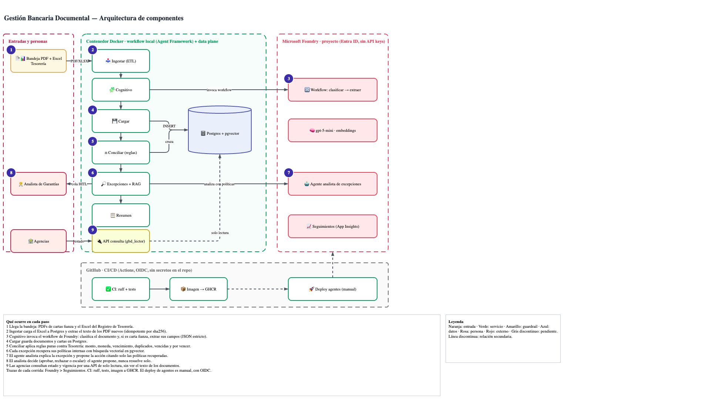
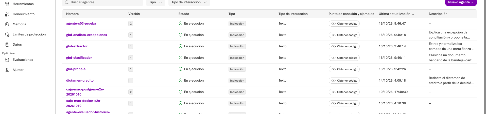
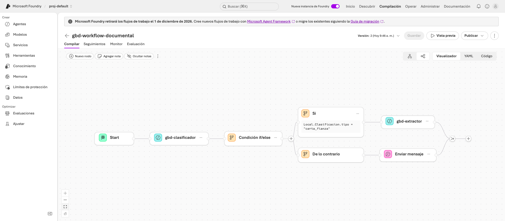

# Gestión Bancaria Documental

Agente de tipo **workflow** que concilia cartas fianza contra el Registro de Garantías de Tesorería. Se inspira en el caso público de automatizar «Billetes Retenidos» en un banco: procesar Excel y PDF, ejecutar ETL, consolidar en una base y conciliar con reglas de negocio, mientras el analista se concentra en revisar excepciones.

Todo el caso es **sintético**: entidad ficticia («Banco Andino Demo»), documentos generados y ninguna credencial en el repo.



El diagrama editable está en [`docs/arquitectura.drawio`](docs/arquitectura.drawio).

## Qué hace

1. **Ingesta** una bandeja de PDF y el Excel de Tesorería (idempotente por `sha256`).
2. **Clasifica y extrae** con un *workflow de Microsoft Foundry*: carta fianza, oficio de liberación u otro. Si es carta fianza, devuelve sus campos en JSON estricto, aunque el PDF venga en español, en inglés o con formatos distintos.
3. **Carga** documentos y cartas en Postgres.
4. **Concilia** con reglas puras y auditables: monto, moneda, vencimiento, beneficiario, duplicadas, vencidas, por vencer, no registradas y registros sin carta.
5. **Explica las excepciones**: recupera las políticas internas con búsqueda vectorial (pgvector) y un agente de Foundry propone la acción, citando solo las políticas recuperadas.
6. **Deja la decisión al analista** (`gbd revisar`): aprobar, rechazar o escalar. El agente propone y nunca resuelve solo.
7. **Consulta de agencias** por una API de solo lectura (rol `gbd_lector`), sin acceso al texto de los documentos.

## Por qué un workflow y no un agente autónomo

El proceso tiene pasos conocidos, orden fijo y reglas de negocio que deben ser auditables. La conciliación es **código determinista** (`src/gbd/dataplane/reglas.py`). El modelo solo interviene donde hace falta lenguaje: leer documentos y redactar la explicación. Un agente autónomo con herramientas añadiría variabilidad donde el banco necesita trazabilidad.

| Nodo | Dónde corre | Tipo |
|---|---|---|
| Ingestar, Cargar, Conciliar, Resumen | Contenedor Docker | determinista |
| Clasificar → Extraer | **Foundry** (workflow `gbd-workflow-documental`) | cognitivo |
| Explicar excepción | **Foundry** (agente `gbd-analista-excepciones`) | cognitivo + RAG |
| Decidir la excepción | Analista | humano (HITL) |

## Lo que se ve en Microsoft Foundry

Los agentes y el workflow se publican con el SDK y quedan en **Build → Agents** y **Build → Agents → Flujos de trabajo**, con visualizador, YAML, versiones y seguimientos (trazas) de cada corrida.

| Agentes `gbd-*` | Workflow en el visualizador |
|---|---|
|  |  |

> **Aviso importante.** Microsoft anunció que **retirará los workflows de Foundry el 1 de diciembre de 2026** y recomienda Microsoft Agent Framework. Por eso este proyecto separa los dos niveles: la orquestación local ya usa Agent Framework (`src/gbd/workflow/graph.py`), y el workflow declarativo de Foundry (`agents/workflow-documental.yaml`) es un YAML portable. Después de esa fecha, la ruta de migración es desplegar la orquestación como *hosted agent* con esta misma imagen. Con ese cambio la base debe ser alcanzable desde la nube, por ejemplo Azure Database for PostgreSQL con pgvector.

## Árbol del proyecto

```
.
├── agents/                  # Definiciones declarativas de Foundry (prompt agents + workflow CSDL)
├── src/gbd/
│   ├── workflow/graph.py    # Orquestación (Microsoft Agent Framework): 6 executors
│   ├── agents/deploy.py     # Publica agentes y workflow en Foundry (versiones inmutables)
│   ├── dataplane/           # Reglas de conciliación (puras) y ETL
│   ├── rag/politicas.py     # Indexado y recuperación con pgvector
│   ├── api/app.py           # Canal de consulta (solo lectura)
│   ├── foundry.py           # Cliente Foundry (Entra ID; sin API keys)
│   └── cli.py               # `gbd migrate | indexar-politicas | deploy-agentes | run | revisar | api`
├── dataplane/
│   ├── sql/                 # Esquema idempotente (schema doc, HNSW, rol gbd_lector)
│   ├── policies.md          # Políticas internas (corpus del RAG)
│   ├── generar_muestras.py  # PDFs/Excel sintéticos con anomalías plantadas + verdad esperada
│   └── samples/             # Bandeja de ejemplo y esperado.json
├── evals/run_eval.py        # Evaluación contra la verdad plantada
├── tests/                   # Unitarios + integración con pgvector
├── docker/                  # Dockerfile (usuario no root, sin secretos) y compose
├── .github/workflows/       # ci · docker (GHCR) · deploy-agents (OIDC, manual)
├── docs/                    # Arquitectura (.drawio + imágenes)
└── Makefile
```

## Cómo correrlo

Requisitos: Docker, Python 3.12+ y una suscripción con un proyecto de Microsoft Foundry que tenga un deployment de chat (`gpt-5-mini`) y otro de embeddings (`text-embedding-3-small`). Debes haber iniciado sesión con `az login` en un tenant que tenga acceso al proyecto.

```bash
cp .env.example .env            # completa POSTGRES_PASSWORD y FOUNDRY_PROJECT_ENDPOINT
make install && make up         # Postgres + pgvector en Docker
make migrate policies           # esquema + embeddings de las políticas
make deploy-agents              # publica agentes y workflow en tu proyecto Foundry
make run                        # ejecuta el workflow sobre la bandeja de ejemplo
make eval                       # compara contra la verdad plantada
.venv/bin/gbd revisar           # cola del analista
```

Dentro del contenedor, con la misma imagen que publica CI:

```bash
make docker-build
make docker-run                 # genera tokens efímeros en out/ (ignorado) y corre el workflow
```

## Resultados de la prueba end to end

Corrida sobre 13 PDF y 1 Excel con 11 casos plantados (3 conciliadas, 1 alerta, 8 excepciones). Se ejecutó desde cero tanto en el host como dentro del contenedor, con Postgres recién creado:

```
clasificación : 13/13
extracción    : 60/60 campos
conciliación  : 12/12 garantías con los códigos exactos
política citada: 8/8 excepciones
```

Idempotencia comprobada: una segunda corrida sobre la misma bandeja reporta 0 documentos nuevos y no reabre excepciones que ya están en la cola.

**Límites que conviene conocer**

- Los PDF sintéticos tienen capa de texto. Para escaneos haría falta OCR (por ejemplo Azure Document Intelligence), que no está implementado.
- Es un caso de 13 documentos: valida el diseño, no el rendimiento.
- El modelo introduce variación: la prioridad que asigna a una excepción de bajo riesgo puede cambiar entre corridas. Las clasificaciones, la extracción y la conciliación no variaron en las pruebas.

## Seguridad y credenciales

- El repo **no contiene secretos**. `.env` está ignorado y `.env.example` solo trae marcadores.
- Foundry se usa con **Microsoft Entra ID** (`DefaultAzureCredential`): no hay API keys.
- La imagen no lleva credenciales. En desarrollo con contenedor se montan tokens de corta vida desde `out/`, que git ignora.
- CI usa OIDC federado para desplegar agentes: no se guarda ningún secreto en GitHub. Los identificadores van como *variables* del environment.
- Las agencias consultan con un rol de solo lectura que no puede leer el texto de los documentos (POL-GAR-08).

## Licencia

MIT, ver [LICENSE](LICENSE).
